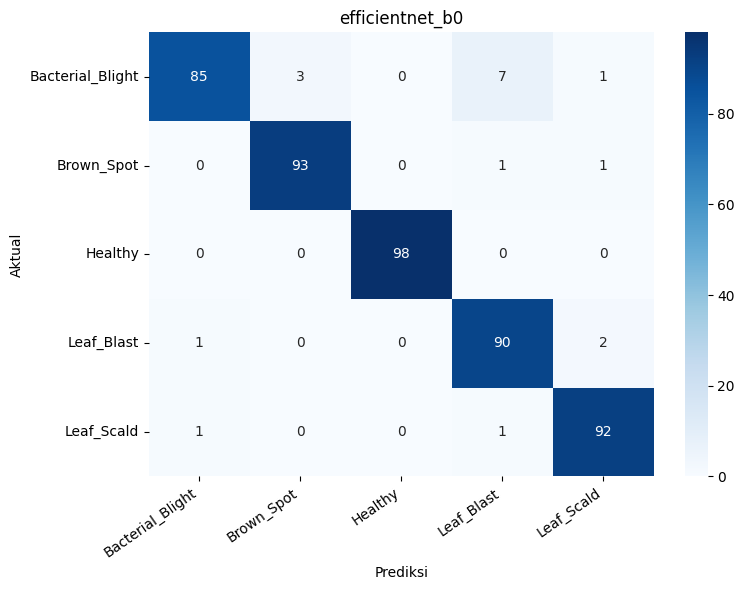
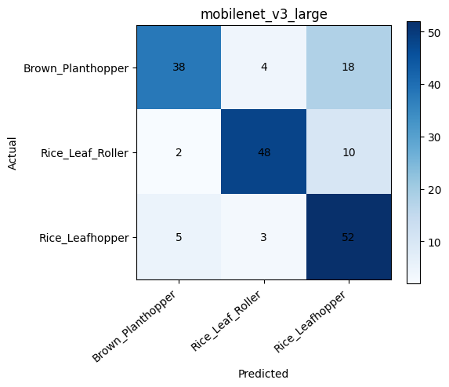

# Oryza Vision

> **Status: dalam pengembangan.** Repository ini masih berisi progres eksperimen computer vision untuk klasifikasi penyakit daun dan hama padi. Model, metrik, dan alur integrasi masih dapat berubah.

## Progres saat ini

| Pekerjaan | Status | Catatan |
|---|---|---|
| Notebook training penyakit | ✅ Selesai dibuat | Membandingkan MobileNetV3-Large dan EfficientNet-B0 |
| Notebook training hama | ✅ Selesai dibuat | Training satu model dengan arsitektur yang dapat dipilih |
| Notebook perbandingan model hama | ✅ Selesai dibuat | Membandingkan MobileNetV3-Large dan EfficientNet-B0 |
| Ekspor model ke TensorFlow Lite | ✅ Selesai | Artefak penyakit dan hama sudah tersedia |
| Validasi hasil konversi TFLite | ✅ Selesai sementara | Konsistensi output diuji pada 10 input sintetis |
| Rekap metrik semua eksperimen | 🔄 Belum lengkap | Baru sebagian confusion matrix yang tersedia di repository |
| Evaluasi model kandidat final | 🔄 Perlu dikerjakan | Perlu classification report dan confusion matrix model terpilih |
| Pengujian foto lapangan | ⏳ Belum | Perlu foto dari kondisi pembibitan sebenarnya |
| Integrasi dan pengujian Flutter | ⏳ Belum | Perlu uji preprocessing, latensi, dan output pada perangkat |
| Finalisasi dokumentasi dan lisensi | ⏳ Belum | Versi dependensi dan lisensi dataset perlu dikonfirmasi |

## Kandidat model saat ini

Kandidat berikut sudah diekspor, tetapi belum dianggap sebagai rilis final sebelum evaluasi lapangan dan integrasi aplikasi selesai.

| Tugas | Arsitektur | Jumlah kelas | Artefak |
|---|---|---:|---|
| Penyakit daun | MobileNetV3-Large | 5 | [`models/disease`](models/disease) |
| Hama | EfficientNet-B0 | 3 | [`models/pest`](models/pest) |

Spesifikasi sementara kedua model:

- Input: `float32`, NHWC, `[1, 224, 224, 3]`.
- Preprocessing: resize sisi terpendek ke 256, center crop 224 × 224, lalu normalisasi ImageNet.
- Output: raw logits; aplikasi perlu menjalankan softmax.
- Urutan kelas harus dibaca dari file `*_labels.json`.

Metadata lengkap:

- [`disease_preprocessing.json`](models/disease/disease_preprocessing.json)
- [`pest_preprocessing.json`](models/pest/pest_preprocessing.json)

## Hasil sementara

Confusion matrix yang saat ini tersedia berasal dari model pembanding, bukan kandidat deployment di atas. Angka precision, recall, dan F1 dihitung kembali dari confusion matrix menggunakan macro average.

| Eksperimen | Sampel | Accuracy | Macro precision | Macro recall | Macro F1 |
|---|---:|---:|---:|---:|---:|
| Penyakit — EfficientNet-B0 | 476 | 96,22% | 96,26% | 96,22% | 96,17% |
| Hama — MobileNetV3-Large | 180 | 76,67% | 78,91% | 76,67% | 76,71% |

### Penyakit — EfficientNet-B0



### Hama — MobileNetV3-Large



Hasil ini belum cukup untuk menyimpulkan performa model final. Confusion matrix dan classification report untuk MobileNetV3-Large penyakit serta EfficientNet-B0 hama masih perlu ditambahkan.

## Validasi konversi sementara

[`conversion-report.json`](reports/conversion-report.json) mencatat perbandingan output model asal dan TFLite pada 10 input sintetis.

| Model | Ukuran | Selisih logit maksimum | Kesamaan top-1 |
|---|---:|---:|---:|
| Penyakit | 16,19 MB | `1.0192e-05` | 100% |
| Hama | 15,49 MB | `1.5050e-06` | 100% |

Hasil tersebut hanya menunjukkan bahwa proses konversi mempertahankan output pada sampel sintetis. Hasil itu bukan ukuran akurasi pada gambar nyata.

## Notebook

- [`disease-training.ipynb`](notebooks/disease-training.ipynb) — kurasi dataset, training, perbandingan dua arsitektur, dan evaluasi penyakit.
- [`pest-training.ipynb`](notebooks/pest-training.ipynb) — training satu model hama.
- [`pest-model-comparison.ipynb`](notebooks/pest-model-comparison.ipynb) — perbandingan dua arsitektur untuk hama.
- [`export-to-tflite.ipynb`](notebooks/export-to-tflite.ipynb) — ekspor checkpoint PyTorch ke TensorFlow Lite.

Notebook dirancang untuk Google Colab dan memasang dependensinya dari cell awal. Konfigurasi training utama menggunakan seed `42` dan split train/validation/test 70%/15%/15%.

## Dataset yang digunakan

- Penyakit: [Project-AgML/rice_leaf_disease_classification](https://huggingface.co/datasets/Project-AgML/rice_leaf_disease_classification)
- Hama: [Project-AgML/CT_PestNet_crop_pest_classification](https://huggingface.co/datasets/Project-AgML/CT_PestNet_crop_pest_classification)

Dataset tidak disimpan di repository. Lisensi, revisi dataset, dan kesesuaian foto dengan kondisi pembibitan target masih perlu diverifikasi sebelum rilis.

## Struktur repository

```text
oryza-vision/
├── models/                   # Kandidat model TFLite dan metadata
├── notebooks/                # Training, perbandingan, dan ekspor
├── reports/                  # Laporan konversi dan visualisasi sementara
└── README.md
```

## Target berikutnya

- [ ] Jalankan ulang eksperimen dan simpan seluruh metrik secara konsisten.
- [ ] Tambahkan classification report dan confusion matrix kandidat model final.
- [ ] Bandingkan ukuran, latensi, macro F1, dan error per kelas.
- [ ] Uji model dengan foto lapangan yang tidak berasal dari dataset training.
- [ ] Verifikasi preprocessing dan urutan label pada aplikasi Flutter.
- [ ] Ukur latensi serta penggunaan memori pada perangkat Android target.
- [ ] Dokumentasikan versi Python, PyTorch, TensorFlow/LiteRT, dan dependensi ekspor.
- [ ] Konfirmasi lisensi dataset dan tentukan lisensi repository.

## Catatan

Prediksi model hanya merupakan indikasi awal, bukan diagnosis definitif. Performa pada dataset uji belum tentu mewakili pencahayaan, latar, kamera, atau fase pertumbuhan tanaman di lapangan.
